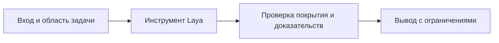

# Переключение режима Laya

Смени один режим гейта в конфигурации плагина. Сначала проверь аргумент сам:
ровно имя настройки и одно значение из списка ниже; пустой аргумент → только
`status`; неизвестное имя, отсутствующее значение или лишние аргументы →
откажись, CLI не вызывай. Передавай значения только как два отдельных
quoted-аргумента, не подставляй всю строку в shell.

Подставь проверенные `<настройка>` и `<значение>` и выполни:

```bash
# ZCODE_PLUGIN_ROOT в Bash может быть не задан: берём installPath из реестра
# установленных плагинов. Это переживает обновление версии плагина.
PLUGIN_ROOT="${ZCODE_PLUGIN_ROOT:-$(node -e 'try{const fs=require("fs"),path=require("path"),os=require("os");const f=path.join(os.homedir(),".zcode","cli","plugins","installed_plugins.json");const j=JSON.parse(fs.readFileSync(f,"utf8"));const p=(j.plugins||[]).find(x=>x.name==="davinci-laya-decisions");if(!p)process.exit(2);process.stdout.write(p.installPath)}catch(e){process.exit(2)}')}"
test -f "$PLUGIN_ROOT/scripts/laya-admin.mjs" || { printf 'Не найден laya-admin.mjs: %s\n' "$PLUGIN_ROOT" >&2; exit 2; }
node "$PLUGIN_ROOT/scripts/laya-admin.mjs" status
node "$PLUGIN_ROOT/scripts/laya-admin.mjs" mode "<настройка>" "<значение>"
node "$PLUGIN_ROOT/scripts/laya-admin.mjs" status
```

Допустимые значения:
- `risk off|shadow|ask` — гейт риска на PreToolUse. `shadow` пишет решения локально и ничего не меняет; `ask` поднимает подтверждение пользователю для подтверждённо опасных вызовов (никогда не выдаёт allow и не отменяет запреты).
- `done off|report|block` — проверка доказательств на Stop. `report` только логирует; `block` разрешает ОДНУ блокировку на сессию при детерминированных пробелах (например, код менялся, тесты не запускались).
- `router off|log|advise` — рекомендация класса задачи на UserPromptSubmit. `advise` добавляет одну строку в контекст (стоит токенов главной модели).
- `sessionContext on|off` — одна строка статуса Laya при старте сессии.

Если пользователь не указал аргументы — покажи текущие режимы (`laya-admin.mjs status`) и объясни разницу между shadow/ask и report/block, предложив включать активные режимы только после просмотра метрик. При включении активного режима один раз кратко объясни его действие.

## Порядок проверки



## Валидация, сохранность и подтверждение результата

До запуска допускай ровно имя настройки и одно значение из таблицы выше. Пустой аргумент показывает только status. Неизвестное имя, отсутствующее значение или лишние аргументы отклоняй. CLI теперь сам отвергает неверные значения (включая sessionContext), но проверка до вызова обязательна. Передавай аргументы безопасно, не исполняй их как shell-код.

| Этап | Проверка |
|---|---|
| До записи | Прочитать status и сохранить прежнее значение |
| Запись | Проверить exit code CLI |
| После записи | Повторить status и сверить фактическое значение |
| Health недоступен | Отдельно прочитать указанный файл конфигурации |
| Несовпадение | Сообщить ошибку, не утверждать успех |

Отчёт: было → стало, путь конфигурации, подтверждённая область применения, обратная команда с прежним значением. Лимит done block сверяй с конфигурацией, не обещай всегда одну блокировку.

Файл переживает рестарт при повторной загрузке того же пути без переопределений; это не проверка реального рестарта. Явная команда пользователя разрешает выбранное переключение, повторного подтверждения не требуй. Для ask/block достаточно одного краткого объяснения вмешательства и имеющихся метрик. Не меняй соседние режимы и не откатывай автоматически.
